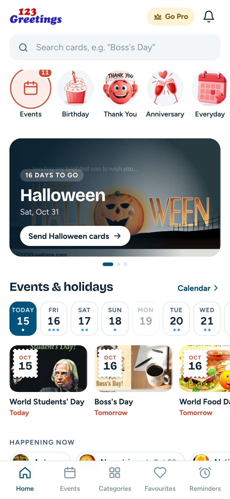

# 123Greetings app: Home screen redesign

A React prototype of a new Home tab for the 123Greetings Android app (`com.g123`). The goal is maximum exposure for every event and general category. The comparison of www.123greetings.com, m.123greetings.com and the current APK, and the reasoning behind each section, are in [docs/home-screen-recommendation.md](docs/home-screen-recommendation.md).

| First screen | Whole feed |
|---|---|
|  | [docs/screenshots/full-feed.jpg](docs/screenshots/full-feed.jpg) |

## Run it

```bash
cd home-screen-design
npm install
npm run dev        # http://localhost:5173
```

On a wide screen you get a phone frame, a "Preview as of" date switch (Oct 15 / 20 / 28) and the feed order with notes. Under 880px wide, the prototype fills the screen like the app. Each tap shows the analytics event it would log.

Add `?today=2026-10-20` to the URL to open on a specific day.

## Layout

```
src/
  App.jsx                 page shell: phone frame, preview-date switch, section map
  HomeScreen.jsx          renders HOME_LAYOUT; card de-duplication; section impressions
  data/
    homeLayout.js         server-driven section order (mirrors the proposed API payload)
    snapshot.js           generated content snapshot of m.123greetings.com (do not hand-edit)
  lib/
    feed.js               date-aware picks: event window, hero events, spotlights
    dates.js              calendar-day helpers
    track.js              analytics stand-in (reuses the APK's existing event names)
  components/             AppBar, CategoryRail, HeroCarousel, EventsSection, EventSpotlight,
                          JustToSay, CardRail, BirthdayHub, RemindersPrompt, NativeAd,
                          CategoryGrid, BottomNav, Img, Icon, SectionHeader
scripts/snapshot.py       regenerates src/data/snapshot.js
```

## Refresh the content

```bash
python3 scripts/snapshot.py /tmp/g123-cache src/data/snapshot.js
```

The script fetches the m-site homepage and event pages into the cache folder. Event dates and weights are listed at the top of the script. Card images load directly from the 123Greetings CDN (`i.123g.us`, `c.123g.us`). If an image is missing, the tile falls back to the thumbnail and then to a lettered placeholder.

## Porting to the app

The app is Expo / React Native, and the components map one-to-one:

- Rails become `FlatList horizontal`, and the feed becomes a `FlatList` of sections keyed by `HOME_LAYOUT`.
- `Img` becomes `expo-image` with a placeholder.
- `lib/feed.js` and `lib/dates.js` are plain JS and can be reused as-is, or moved to the home-feed API.
