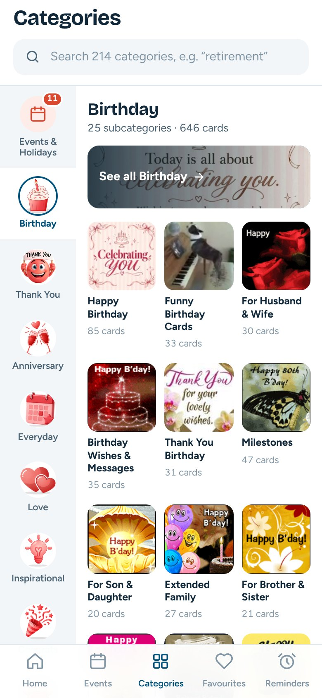
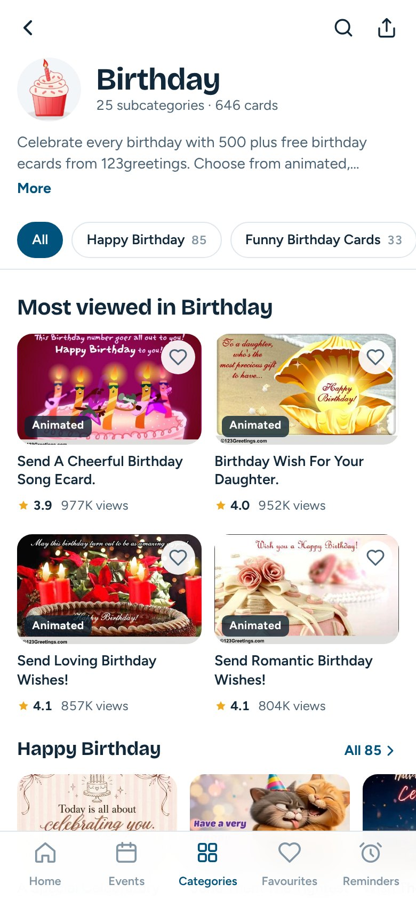
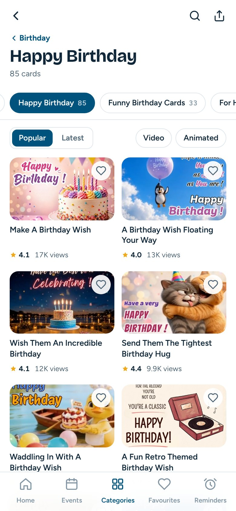

# 123Greetings app: Home and category screens redesign

A React prototype of new Home, Categories, category and subcategory screens for the 123Greetings Android app (`com.g123`). The goal is maximum exposure for every event, category and subcategory.

- [docs/home-screen-recommendation.md](docs/home-screen-recommendation.md) compares www.123greetings.com, m.123greetings.com and the current APK for Home, and explains each section.
- [docs/category-screens-recommendation.md](docs/category-screens-recommendation.md) does the same for the Categories tab, category pages and subcategory pages.

| Home | Categories tab | Category | Subcategory |
|---|---|---|---|
|  |  |  |  |

## Run it

```bash
cd home-screen-design
npm install
npm run dev        # http://localhost:5173
```

On a wide screen you get a phone frame and a side panel with:

- a **Screen** switcher (Home, Categories, Category: Birthday, Subcategory: Happy Birthday)
- the design notes for the current screen
- on Home, a "Preview as of" date switch (Oct 15 / 20 / 28)

Under 880px wide, the prototype fills the screen like the app. Each tap shows the analytics event it would log.

The screens are linked like the app: category taps on Home open category pages, the Categories tab keeps its own back stack, and the back button restores scroll position.

Direct links: `?screen=home|categories|category|subcategory`, plus `&today=2026-10-20` for a specific date.

## Layout

```
src/
  App.jsx                   page shell: phone frame, screen switcher, side-panel notes
  AppShell.jsx              the phone's app: a back stack per tab, favourites, bottom nav
  nav.js                    navigation context and tab roots
  screens/
    HomeScreen.jsx          renders HOME_LAYOUT; card de-duplication; section impressions
    CategoriesScreen.jsx    Categories tab: category rail, subcategory pane, Events pane, search
    CategoryScreen.jsx      category overview (shelves) and subcategory grid (sort, filter, load more)
  data/
    homeLayout.js           server-driven Home section order
    screenNotes.js          side-panel notes per screen
    snapshot.js             generated: Home content (events, rails)
    taxonomy.js             generated: 17 categories, 214 subcategories, counts, lead art
  lib/                      feed (date logic), dates, format, route, track, useCategoryCards
  components/               shared UI: TopBar, SubcategoryChips, GridCard, CardRail, …
public/data/categories/     generated: first page of cards per subcategory, one file per category
scripts/
  snapshot.py               regenerates src/data/snapshot.js
  taxonomy.py               regenerates src/data/taxonomy.js and public/data/categories/
```

## Refresh the content

```bash
python3 scripts/snapshot.py /tmp/g123-cache src/data/snapshot.js
python3 scripts/taxonomy.py /tmp/g123-cache .
```

Both scripts fetch pages from m.123greetings.com into the cache folder. Card images load directly from the 123Greetings CDN (`i.123g.us`, `c.123g.us`). If an image is missing, the tile falls back to the thumbnail and then to a lettered placeholder.

## Porting to the app

The app is Expo / React Native, and the components map one-to-one:

- Rails become `FlatList horizontal`, feeds and grids become `FlatList` (`numColumns={2}` for the card grid), and sticky chips become `stickyHeaderIndices`.
- The tab stacks match `@react-navigation/bottom-tabs` with a native stack per tab.
- `useCategoryCards` maps to the existing `get_sub_categories_cards` call, and `taxonomy.js` to `get_categories`.
- `lib/feed.js`, `lib/dates.js` and `lib/format.js` are plain JS and can be reused as-is.
