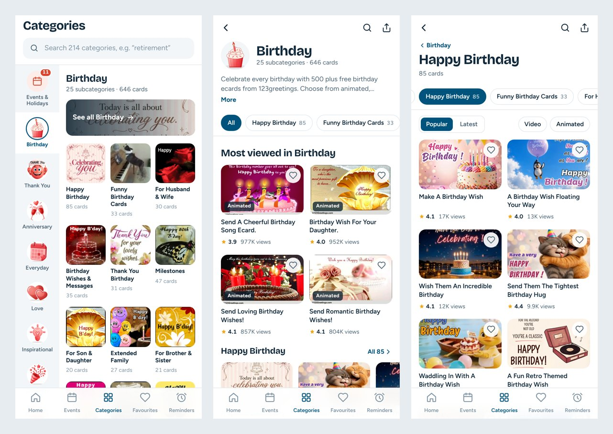

# Categories, category and subcategory screens for the 123Greetings app (com.g123)

Snapshot taken **Thu, Oct 15, 2026**: the www and m-site Birthday and Happy Birthday pages, plus every category page on m.123greetings.com. App structure comes from the bundle in this repo. Companion to [home-screen-recommendation.md](home-screen-recommendation.md).

## The tree

17 general categories hold **214 subcategories**. Every subcategory on the m-site carries a card count, e.g. "Happy Birthday (85 Cards)". The sizes vary a lot:

| Biggest | Subcategories | Smallest | Subcategories |
|---|---|---|---|
| Birthday | 25 | World Languages | 3 (Spanish, French, German) |
| Everyday | 22 | Flowers | 5 |
| Love | 20 | Cute | 7 |
| Friendship | 19 | Stay in Touch | 8 |

A few subcategories are cross-listed. For example, Thank You Birthday (`/thank_you/birthday/`) appears under both Birthday and Thank You.

## What each surface does today

| | www.123greetings.com | m.123greetings.com | App (com.g123 v1.181) |
|---|---|---|---|
| **Category page (Birthday)** | A shelf for all 25 subcategories, 3 cards each, with "Browse all N cards". Subcategory list in the sidebar | Cards for only **3 of 25** subcategories (4 each). The other 22 appear only as text links at the bottom, below **4 ad slots**. 12 cards on the whole page | `EcardCategoriesScreen` → `EcardSubcategoriesScreen`, loaded from `get_categories` |
| **Subcategory page (Happy Birthday)** | 10 cards per page; Latest / Most Popular / Video | 12 cards per page in blocks of 4 between ads (4 ad slots). Latest / Popular / Videos / GIF tabs. Numbered pages (1–8). Siblings listed at the bottom | Cards from `get_sub_categories_cards` (`subcategoryid`, `subcategorytext`) |
| **Per-card data** | Views, rating | Views ("3,087"), rating ("3.9/5") | n/a |
| **How you get there** | Top menu | Hamburger drawer (4 groups) | Home Quick Access only reaches Holidays and Occasions (`CATEGORY_PAGE_VIEW_{HOLIDAYS,OCCASIONS}`) |

**In short:** the desktop site exposes the tree well but is built for a mouse. The m-site hides most of it behind ads and text links. The app has the right API calls, but Home offers only two doors into the tree.

## Recommended design

The prototype has all three screens, linked to Home: category rail taps, Birthday "for whom" chips and Just to say chips open them directly. The preview links are `?screen=categories`, `?screen=category` and `?screen=subcategory`.

### 1. Categories tab (new bottom tab)

| Part | What it does | Why |
|---|---|---|
| Search field | Filters all 17 categories and 214 subcategories by name as you type. "retire" finds Congrats › Retirement and At Work › Retirement | The tree is too big to scan, and people think in occasions, not in our hierarchy |
| Category rail (left, 92pt) | Events & Holidays first (badged with this week's count), then all 17 categories with their art. The selected item joins the pane like a tab | The whole top level sits in one column; the first 7 items fit without scrolling |
| Pane header | Name, subcategory count, card total ("25 subcategories · 646 cards") | Sets expectations before scrolling |
| "See all Birthday" banner | Opens the category page | One tap to the full overview |
| Subcategory grid (3 across) | Each tile shows the subcategory's newest card as art, its name, and its card count | Every subcategory is two taps from any screen |
| Events & Holidays pane | Big holidays with countdowns, the next 14 days as a dated list, "Happening now", Full calendar | Events behave like a category, so they live here too ([screenshot](screenshots/categories-events.jpg)) |

The search has a no-match state that offers to search the cards themselves ([screenshot](screenshots/categories-search.jpg)).

### 2. Category page (e.g. Birthday)

| Part | What it does | Why |
|---|---|---|
| Header | Art, name, "25 subcategories · 646 cards", the intro text clamped to 2 lines with "More" | Keeps the site's SEO intro without pushing cards down |
| Sticky subcategory chips | "All" plus every subcategory with its count, pinned under the top bar | All 25 are reachable from the first screen and at every scroll depth. The m-site buries 22 of them |
| Most viewed in Birthday | 2 × 2 grid of the four most-viewed cards | The m-site's own view counts (977K, 952K…) are the best signal we have |
| A shelf per subcategory | Every subcategory gets a row of up to 6 cards with rating and views, plus "All 85 ›" | Desktop's best idea, sized for a phone. No card appears twice on the page |
| Ads | One native ad after the 5th shelf and one after the 15th | 2 ads for 25 shelves, against the m-site's 4 ads for 12 cards |
| Other categories | Rail of the other 16 categories | Ends with a sideways move instead of a dead end |

### 3. Subcategory page (e.g. Happy Birthday)

| Part | What it does | Why |
|---|---|---|
| Breadcrumb + title | "‹ Birthday", "Happy Birthday", "85 cards" | Shows where you are, with one tap back to the overview |
| Sibling chips | Same sticky bar; the current subcategory is selected and scrolled into view | Switch from Happy Birthday to Milestones without the back button |
| Sort | Popular (by views, default) or Latest | Maps to the site's Popular / Latest tabs. Popular first because the best cards should lead |
| Filters | Video, Animated | Maps to the site's Videos / GIF Cards tabs. Birthday's first pages hold 55 video and 176 animated cards |
| 2-column grid | 5:3 art, favourite heart, title, ★ rating and views. Titles reserve two lines so rows align | Big enough to judge a card. The heart feeds the existing Favourites tab |
| Inline ad | One native ad after the 8th card | Instead of an ad between every 4 cards |
| Progress | "Showing 12 of 85 cards", progress bar, Load more | Replaces 8 numbered page links |
| Up next | The next subcategory, with art and count | Keeps people browsing instead of hitting the bottom ([full page](screenshots/subcategory-full.jpg)) |

## API notes

- **`get_categories`** should return, per subcategory, `count` and a `lead` image (newest card). That's all the Categories tab needs, about 70 KB for the whole tree (`src/data/taxonomy.js` is the shape).
- **`get_sub_categories_cards`** should accept `sort=popular|latest`, `format=video|animated` and `page`, and return `total` plus per-format counts. The prototype sorts and filters only the first page it has, which a real backend shouldn't do.
- **The category page** needs the first ~6 cards of every subcategory in one call (`public/data/categories/<id>.json` is the shape). One request per category, not 25.
- **Cross-listed subcategories** (Thank You Birthday) should keep one id, so favourites and analytics don't split.

## Analytics added

| Event | When |
|---|---|
| `CATEGORY_RAIL_SELECT_<ID>` | A category is picked in the Categories tab rail |
| `SUBCATEGORY_CLICK_<ID>` (with `from`) | A subcategory tile or search result is opened |
| `CATEGORY_PAGE_VIEW`, `SUBCATEGORY_PAGE_VIEW` | A screen is shown (extends today's `CATEGORY_PAGE_VIEW_*`) |
| `SUBCATEGORY_CHIP_<ID>`, `CATEGORY_CHIP_ALL_<ID>` | A sticky chip is used |
| `CATEGORY_SHELF_VIEW_ALL_<ID>` | "All N ›" on a shelf |
| `SUBCATEGORY_SORT_*`, `SUBCATEGORY_FILTER_*`, `SUBCATEGORY_LOAD_MORE` | The toolbar and Load more on a subcategory page |
| `SUBCATEGORY_UP_NEXT_<ID>` | The Up next tile |
| `CARD_FAVOURITE_ADD`, `CARD_FAVOURITE_REMOVE`, `CARD_DETAILS_OPEN` | Card actions |

Worth watching: the share of subcategory opens that come from chips and Up next (lateral) versus the back button (vertical), and how many distinct subcategories are opened per session.

## Notes on the prototype

- Content is a crawl of m.123greetings.com from Oct 15, 2026 (`scripts/taxonomy.py`): the first page (12 cards) of each subcategory. Load more only logs its event.
- The card detail screen, Events, Favourites and Reminders tabs are not part of this prototype. Taps there log their analytics event.
- Images load from the 123Greetings CDN. A missing image falls back to the thumbnail, then to a lettered tile.
